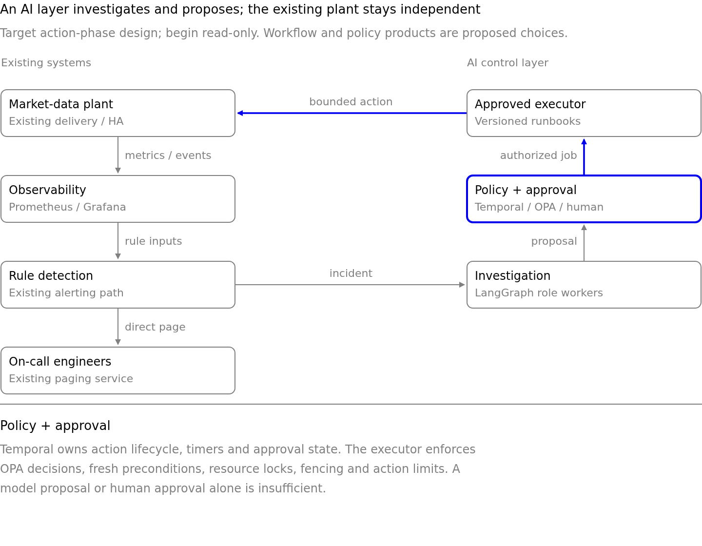
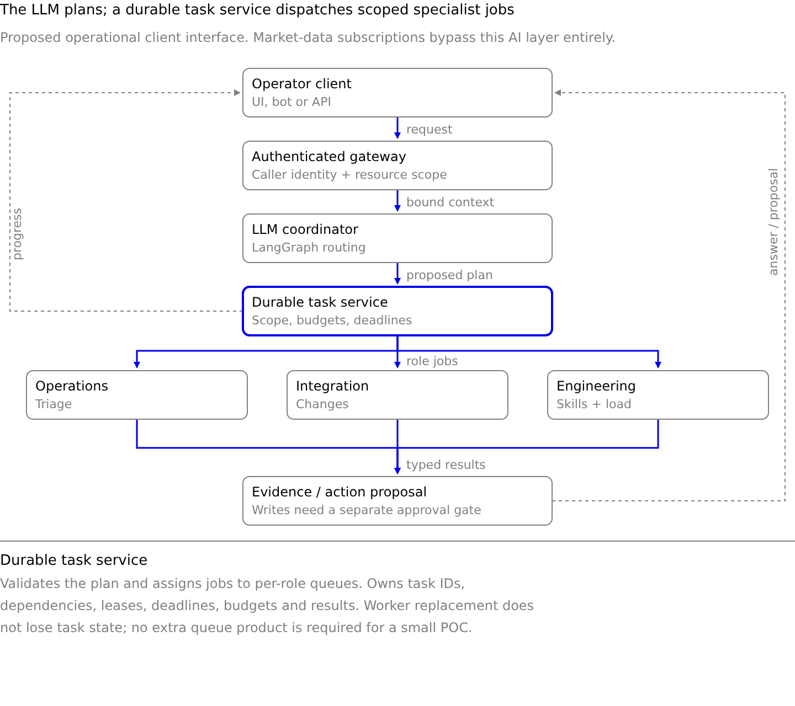

# AI operations layer for the market-data plant

**Status:** initial proposal for architect peer review. **Date:** 14 November 2026. **Implementation status:** design only; no production integration, production changes, or fleet-scale validation.

For component technologies, AI model candidates, streaming ingestion boundaries, and capacity qualification, see the [stack and model reference design](production-stack-design.md). That follow-on design explicitly keeps Python out of the continuous telemetry path. Its separate review and agreed dispositions are recorded in the [review record](architecture-reviews.md); confirmation of the corrective revision remains pending. The initial proposal's two reviews do not cover the extension.

## 1. Add intelligence above existing systems

Build an **AI layer over the existing messaging plant, Prometheus/Grafana, and operational tooling**. The layer gathers evidence, delegates investigations, develops reusable skills, proposes changes, executes permitted runbooks through a separate enforcement boundary, and reports progress. Existing delivery, monitoring, paging, and time-critical protection continue without the AI layer.

The recommended starting point is **LangGraph for bounded investigations**, existing observability APIs for evidence, and an authenticated incident/task service. Introduce **Temporal for durable action workflows** when the POC reaches approval-gated execution, unless existing automation already satisfies those requirements. Model reasoning never grants production authority.

### Confirmed requirements and unverified details

| Confirmed by the plant owner | Still to establish with engineers |
| --- | --- |
| Internal proprietary pub/sub software, conceptually similar to 60East AMPS | Transport, filtering/conflation, ordering, replay, acknowledgement, and HA semantics; AMPS features are not assumed |
| More than 2,000 servers and 20,000 processes | Sites, failure domains, deployment model, process supervisor, and inventory interfaces |
| Existing Prometheus/Grafana contains infrastructure and messaging statistics | Actual metric schemas, labels, coverage, retention, query capacity, alert routing, and access controls |
| Individual process-level metrics are mandatory | Stable process identity and joins between telemetry, runtime topology, changes, and clients |
| Collection intervals vary by metric and are adjustable; five seconds is one existing setting, not a universal interval | Supported configuration APIs, allowed ranges, source refresh versus scrape intervals, and cost/latency effects |
| Integration deploys changes; operations triages/troubleshoots; engineering owns capacity/scaling and develops telemetry skills | Named human owners, approval policies, client/feed SLOs, data handling, and production promotion criteria |

The goal is reduced repetitive toil and faster, auditable decisions. This proposal does not promise zero hallucinations, certain root cause, or production suitability based on a simulation.

### Keep three operating timescales separate

- **Delivery and protection:** existing plant controllers enforce sequence correctness and time-critical failover. No synchronous LLM or central workflow dependency is introduced.
- **Continuous detection:** existing rules and alerting detect symptoms and page directly. Missing telemetry is a visibility problem, not evidence of health.
- **Investigation and change:** event-triggered or operator-requested workflows gather evidence, test hypotheses, request approval, and verify outcomes. Failure of these workflows must not stop delivery or paging.

Use a small worker pool with incident-scoped tasks, not one LLM agent per process. Agreement among multiple agents is not independent evidence.

## 2. Reuse products; build the plant-specific integration

| Capability | Initial choice | Boundary and adoption condition |
| --- | --- | --- |
| Metrics and dashboards | **Existing Prometheus/Grafana** | Read-only bounded query APIs, existing recording rules and dashboards. Do not replace the backend to start the POC. |
| Detection and paging | Existing alert path; identify Prometheus/Alertmanager, Grafana Alerting, or other ownership | Add a deduplicated incident integration without duplicate paging. Alertmanager supports grouping and inhibition; rules must preserve visibility of client impact. [1] |
| Agent orchestration | **LangGraph**, with selected LangChain model/tool integrations | Explicit state, bounded delegation, typed results, and durable checkpoints for investigation. No unrestricted shell, SSH, or model-selected production endpoints. [2] |
| Operational workflow | **Temporal**, conditional on action-phase requirements and incumbent capability | Own action state, deadlines, approval, dispatch, reconciliation, and verification. External calls and side effects run as activities with explicit retry policy. [3] |
| Authorization and execution | Separate executor with existing policy services or **OPA** as the reference option; existing automation or supported job platform | Executor enforces decisions and invokes approved runbooks. Ansible Automation Platform is an option for controlled host-level job templates, not a required replacement. [4][5] |
| Evidence and knowledge | Existing logs/inventory/change records; existing durable task/evidence services or PostgreSQL as the reference option; object storage where needed | Git-reviewed skills/runbooks. Retrieval helps find procedures but does not establish live plant state. Add vector search only after proving useful retrieval gains. |
| Agent tracing and evaluation | **LangSmith** if approved for data handling; otherwise an approved internal alternative | Dataset versioning, tool/model traces, cost, failures, and engineer feedback. Agent observability is distinct from plant observability. [6] |
| Identity and operator interface | Existing enterprise SSO, service identities, secrets manager, incident console and/or Slack/Teams | Bots display factual progress and collect authenticated decisions; chat text alone is not production authorization. |

Do not mandate an observability migration. OpenTelemetry Collector can fill demonstrated collection/routing gaps. Mimir can be evaluated if measured availability, retention, or query requirements exceed the current metrics backend; its current preferred ingest architecture has a Kafka dependency. Loki, Tempo, ClickHouse, additional queues, and graph/vector stores remain conditional, not default POC components. [7][8]

No plant migration to Kubernetes is assumed. Run the AI services on an approved existing VM/container platform and use private interfaces to the current process supervisors and automation systems.

### Put an LLM coordinator behind the operator client's authenticated API

Here, **client means the operational UI, bot, or API consumer**. A market-data subscriber may expose a separate operational assistant interface, but the LLM never sits between a publisher and a subscriber's real-time messages. The existing subscription protocol remains unchanged.

The client submits a request to an authenticated API. That API binds the caller, environment, allowed resources, session/incident, and request ID before any model runs. An LLM coordinator interprets intent, asks for missing scope when necessary, and proposes a bounded task plan. A deterministic task service validates that plan and dispatches it to role-specific worker pools; the model cannot bypass that service by calling production tools directly.

| Component | Responsibility | Durable or security boundary |
| --- | --- | --- |
| Operator UI / bot / API client | Submit a question or operational request; view evidence/progress; approve or reject an exact proposal | Authenticate users and protect approval callbacks against forgery/replay; natural-language assent alone does not approve an action |
| Request gateway | Bind caller scope, validate input, rate-limit, assign/deduplicate request IDs | Caller identity and resource entitlements come from trusted services, not model output |
| LLM coordinator | Classify intent, retrieve applicable approved skills, choose specialist tasks, and synthesize supported results | LangGraph defines permitted routing and bounded branching; policy validates every delegated scope and tool request |
| Task service and role queues | Own dispatch, dependencies, leases, deadlines, retry policy, budgets, and results | Use durable task/evidence storage; Temporal task queues/workflows can supply this lifecycle in the action phase. Do not add a second queue product solely for agent orchestration |
| Operations / integration / engineering worker pools | Execute their scoped investigation or sandbox skill-development tasks | Independently deployable workers with role-specific tools, identities, concurrency limits, and no shared mutable conversation memory |
| Evidence and progress API | Return factual task state and evidence-backed results to the client | Authorize every read and stream against current viewer scope; the durable task record is authoritative; token streaming is not completion or authorization |

Pool workers are reusable processes/services, not permanent personalities or one agent per plant process. Incident/task context lives in the durable store and is loaded by task ID, so a worker can be replaced without losing the investigation. Give each worker only the evidence and capabilities its task needs. Effective permissions are the intersection of caller scope, service identity, role capability, approved skill version, and task policy; delegation can only narrow them.

Stored evidence and derived results retain resource/client scope metadata. Authorize every task/status/evidence read, stream subscription, and synthesized response against the current viewer's entitlements. Task IDs, evidence references, shared incidents, and deduplication never confer access. Synthesis may use only evidence authorized for its audience; a summary must not leak broader-scope findings.

For a low-volume POC, role-specific queues can be logical queues in the task service rather than extra infrastructure. Independently scale worker concurrency to incident demand and telemetry/model budgets, not the 20,000-process inventory. Deduplicate by request/task ID, reject late or superseded results, cap delegation depth, and cancel pending work when its parent expires; reconcile any side effect already dispatched. Retry read-only work only within its budget and deadline, and never blindly retry a mutation.

Authenticated cancellation or system-enforced expiry is a durable task-tree transition: prevent new delegation, retries, and action dispatch, invalidate pending action proposals, and request bounded stopping of running read-only work. Already-dispatched effects remain under reconciliation. Report cancellation/expiry separately from action outcome; disconnecting a client or closing its stream is not cancellation.

**Example request:** “Why is this feed stale for these clients?” Operations checks process delivery evidence and dependencies; integration checks contemporaneous changes and unaffected controls; engineering checks capacity and whether the existing telemetry resolution is sufficient. Run these tasks concurrently only when their inputs are independent. Results include evidence references and contradictions; the coordinator produces a qualified answer, requests a discriminating check, or submits a typed action proposal. If specialists disagree, preserve the disagreement and escalate rather than vote a hypothesis into fact. Any action still goes through Section 6.

### Give LangGraph and the action workflow distinct ownership

LangGraph owns reasoning and checkpoints within a bounded investigation task and produces a result/proposal. The task's lifecycle authority depends on the phase:

| Phase | Lifecycle and dispatch authority | LangGraph responsibility |
| --- | --- | --- |
| Read-only POC | PostgreSQL-backed task service, or a suitable incumbent, owns intake, task state, leases, deadlines, cancellation, budgets and durable dispatch. Temporal is not required | Persist investigation checkpoints and return evidence/results within the task service's limits |
| Action phase, if Temporal is adopted | Temporal owns incident/task/action lifecycle and dispatch after intake handoff; PostgreSQL retains intake/outbox, evidence and UI projections, not a competing lifecycle scheduler | Run bounded investigation tasks through a service/activity boundary; cannot override workflow cancellation or authorize actions |

Keep an incumbent workflow service instead of Temporal if it satisfies the same contracts. When changing lifecycle authority, drain or explicitly cancel/reconcile old tasks before enabling the new dispatcher for their scope; never let both schedule the same task. Use stable incident, investigation, task, and action IDs; retries query existing work rather than creating duplicate actions. Assign one retry owner per boundary and use durable deduplication/dispatch so a crash between recording and enqueueing work cannot lose it.

Do not place raw logs or metric histories in workflow histories. Store scoped evidence with timestamps and integrity metadata; pass references and bounded summaries. Persist deadlines, budgets, and tool/action versions alongside task state. A restart must not revive expired approval or silently upgrade a running task to a new skill.

Temporal's native LangGraph integration is currently documented as **Public Preview**. The initial design does not depend on it: use a read-only investigation service/activity boundary and durable action workflows. Evaluate the integration separately with pinned versions and restart/replay tests. LangGraph persistence is also not a substitute for correctly handling side effects and duplicate requests. [2][3]

## 3. Define evidence and action contracts around the proprietary bus

Four plant-specific integrations carry the domain knowledge:

1. **Telemetry:** map existing metrics to known units, counters/gauges/distributions, reset semantics, collection settings, timestamps, and freshness. Return the actual query, scope, result, and missing-data indicators. Limit query duration, range, result size, concurrency, and cost.
2. **Topology:** join publishers, relays, feeds/topics/subjects, subscriptions, clients, hosts, software/config versions, and redundancy groups using authoritative inventory and runtime configuration. Record dependency direction, failure domain, version, and last validation time.
3. **Actions:** wrap engineers' existing supported commands/APIs in versioned, typed runbooks with explicit targets, preconditions, outcome reconciliation, safe stopping, and recovery procedures. Do not invent generic restart/failover semantics.
4. **Verification:** use supported sequence/freshness checks and independent subscriber observations to establish the delivery outcome. A process being alive does not prove a client receives correct data.

Every evidence item must identify the resource, observation period, collection/query time, source, units, and relevant configuration generation. Distinguish a measured zero from an absent series, a stopped process, and a failed query. Interpret filtering/conflation and session boundaries before labeling a sequence discontinuity as lost data.

If plant telemetry travels over the bus being monitored, maintain an independent host/process heartbeat or external delivery probe. Otherwise the system may confuse loss of observability with simultaneous failure of all observed processes.

### Preserve process-level detail without flooding the LLM

Process evidence is mandatory across the fleet. Use a stable logical process identity plus a lifecycle generation/start time; a reused PID is not the same process. Keep rich, changing metadata in inventory or bounded information metrics where practical instead of repeating every attribute on every series.

| Diagnostic category | Process-level evidence and interpretation |
| --- | --- |
| Lifecycle and change | Expected presence, running generation, restarts, role, host/site, software/config version and deployment history |
| Resources | CPU relative to allocated cores/quota, memory, threads, file descriptors, I/O, and scheduling/runtime/GC signals where available; do not falsely attribute host NIC metrics to a specific process |
| Message handling | Ingress/egress rates, queues and queue age, latency distributions, errors/drops, message freshness, reset-aware counters |
| Dependencies | Connections, disconnects, publisher/subscriber relationships, slow-consumer evidence, and topology context |
| Redundancy | Active/standby role, supported replay/replication progress, readiness, ownership/fencing generation |

Start an investigation at the affected feed/service/client, identify candidate processes, and compare them with healthy peers and their upstream/downstream neighbours. Broad summaries find candidates; retain targeted process histories for diagnosis and verification. Cardinality controls must not eliminate required process identity.

Client-facing SLOs cover **freshness, completeness/order, correctness, and availability**, scoped to the delivery boundary actually observed. Host health is supporting evidence. Aggregate compatible histogram distributions rather than averaging process p99s; assess clock synchronization/uncertainty before interpreting cross-host latency. Distinguish expected market-session silence from a stalled feed. [9]

## 4. Engineering owns telemetry and capacity skills

The engineering agent develops and maintains skills for metric discovery, process/topology mapping, sampling design, query design, capacity forecasting, headroom analysis, and bounded scaling. Metric intervals are **per-metric configuration**, not a hard-coded five-second architecture choice.

A telemetry-engineering skill should discover current source refresh, scrape/export interval, aggregation/window semantics, label cardinality, retention, and observed freshness. It then proposes settings justified by detection needs and collection cost. Faster scraping cannot reveal information that the source does not update; increasing future resolution cannot reconstruct a missed past event.

During an investigation, operations may request higher-resolution evidence for named processes and metrics. Engineering evaluates whether it is useful and affordable, and proposes a time-bounded change. Execution still crosses the same policy/approval boundary as any other production configuration change.

Each sampling change specifies targets, old/new settings, allowed bounds, estimated ingestion and host overhead, duration, restoration authorization, and independent success/stop checks. Prefer a small canary and verify actual observed cadence and delivery overhead. Expiry initiates durable reconciliation; it does not guarantee immediate restoration during a partition or executor outage. Define the outage behavior before enabling the change: use a supported target-local TTL or a separately authorized restoration mechanism where available; otherwise mark restoration overdue/unknown and escalate through an independent operational path. Reconcile conflicting edits rather than overwriting a newer operator change. Prevent multiple concurrent investigations from collectively exceeding telemetry budgets.

Engineering cannot silently weaken alert coverage, redefine client SLOs, alter acceptance thresholds to pass its own tests, or give itself broader write access. Changes to safety policy and mandatory monitoring remain separately owned and reviewed. Initially all production tuning requires approval; proven routines may later run within explicitly preapproved limits.

### Skills can improve without self-authorizing production code

A skill is a versioned package of purpose, supported inputs, metric/topology assumptions, permitted tools, diagnostic queries, optional reviewed action IDs, stop conditions, verification procedure, owner, and eval fixtures. Instructions and executable scripts have separate review and execution controls.

The engineering agent can draft or revise skill code, queries, and tests **in a development sandbox** using engineers' runbooks and incident feedback. Candidate versions undergo deterministic tests, held-out incident evaluation, security/policy checks, and human owner review before promotion to an immutable approved version. Runtime tasks pin that version; rollback and revocation must be supported. The agent that authors a candidate cannot approve its own production promotion.

An operations incident can therefore generate an engineering task to improve a missing diagnostic skill, but that incident does not grant permission to execute newly generated code in production. Emergency response continues through existing approved procedures.

### Size from measured workload

Fleet count is not ingestion capacity. Measure active series, label churn, histogram representation, per-metric intervals, log/event bytes, retention, peak multiplier, and query concurrency. For mixed cadence, total sample rate is the sum of each metric group's active series divided by its collection interval.

**Illustrative only:** 20,000 processes × 100 scalar series = 2,000,000 active series. If all those example series were collected every 10 seconds, the rate would be 200,000 samples/second, or 17.28 billion/day, before other metrics or replication. Neither the series count nor the interval is a measured production value. Storage requires separate compression/index/retention measurements.

Sampled instantaneous gauges can miss microbursts; counters, histograms, and interval maxima can preserve intervening events if instrumented appropriately. Collection cadence is not end-to-end detection latency: source refresh, ingestion, evaluation, query windows, alert persistence, and notification grouping all contribute.

Protect delivery from telemetry CPU, memory, disk, and network overhead. Preserve essential counters/SLO signals; explicitly report loss of diagnostic detail when shedding load. Respect scraper sharding and metric single-writer constraints, and test bounded queues and catch-up behavior rather than assuming persistence prevents all telemetry loss. [7]

## 5. Match agent responsibilities to the three teams

| Role | Responsibility | Authority boundary |
| --- | --- | --- |
| Coordinator | Deduplicate incidents, delegate tasks, track dependencies, deadlines, and escalation | Cannot expand scope, budgets, or permissions by asking another agent |
| Operations | Triage, inspect scoped telemetry/logs/topology, test hypotheses, request missing evidence, propose recovery | Read-only tools and typed proposals; no direct plant writes |
| Integration | Analyze change impact, validate readiness/canaries, prepare deployment/rollback plans, submit approved jobs | Existing release/change controls remain authoritative; deployment timing is not proof of causality |
| Engineering | Build telemetry/capacity skills, propose collection tuning, forecast peaks and failure/replay headroom, plan scaling | Sandbox authoring and proposals; no self-promotion, policy changes, or unrestricted production tuning |
| Verifier | Apply independently defined postconditions and observe client delivery and controls | Cannot declare success from an executor exit code or the acting agent's narrative |

Each task carries incident ID, permitted resources, evidence/time scope, deadline, tool/cost budget, skill version, and acceptance criteria. Results separate **observations, hypotheses, contradicting evidence, missing checks, and proposed next tests**. Do not invent probability scores from model confidence.

Use separate identities, least-privilege credentials, and network boundaries for investigators, skill builders, executors, and approvers. Separate processes under one Unix user are not a security sandbox. Enforce resource and client/tenant restrictions at tool services, not just in prompts. Treat logs, tickets, runbooks, and tool outputs as untrusted data; retrieved instructions cannot grant authority.

For an initial POC, bound investigation concurrency, depth, wall time, tool calls, and model spend. Queue work by severity, coalesce duplicate alerts, and fall back to on-call engineers when limits or provider failures are reached. An agent outage is not a reason to suppress existing pages.

## 6. Gate and reconcile every production action

The executor independently enforces the following, even if an LLM proposes an action and a human approves it:

1. **Identity and scope:** exact environment, resource set, permitted runbook, typed parameters, and client/tenant restrictions. No arbitrary shell, URLs, inventory expansion, credential overrides, or newly generated, unreviewed, or unpromoted code at runtime. Executable skill components, whether authored by a human or an agent, run only through approved, version-pinned execution controls; promoting a diagnostic skill does not grant production write permission.
2. **Bound approval:** authenticated approver identity, action digest, parameters, targets, runbook version, expiry, and required separation of duties. A material change invalidates approval. High-impact actions can require dual approval.
3. **Fresh preconditions:** recheck metric freshness using the relevant metric contract, topology/config generations, market/session constraints, change conflicts, standby readiness, and capacity at execution time.
4. **Locks and fencing:** serialize on the actual shared resource/redundancy group, not only incident ID. Use target-enforced fencing/generation checks where possible. Do not automate unsafe failover if stale owners cannot be prevented from acting.
5. **Bounded impact:** canary targets, maximum unavailable capacity, action concurrency, cooldowns, deadlines, and an operator kill switch independent of the agent. Limits are domain-specific, not a universal fleet percentage.
6. **Idempotency and unknown outcomes:** durable action ID and intent record. Reconcile target state after lost acknowledgements or timeout before any retry. Temporal, queues, and HTTP success cannot guarantee exactly-once external effects by themselves.
7. **Independent verification:** check delivery continuity/freshness over an agreed window, affected clients, and unaffected controls. Record recovered, degraded, or unknown; symptom recovery alone does not confirm root cause.
8. **Fail closed for new writes:** policy/approval/audit failure denies new writes. Cancellation cannot undo an already-issued command: reconcile it. Compensation/failback is a separate validated action and must not introduce duplicate or reordered data.

Store action intent, approvals, policy/runbook/model versions, evidence references, executor receipts, and verification outcomes in an access-controlled durable audit trail. Define retention and recovery objectives with security/operations. Exclude credentials and unnecessary quote/client payloads from model and tracing services; provider eligibility, licensing, residency, and retention require approval before real evidence is sent externally.

## 7. Investigate causes with discriminating evidence

For downstream sequence gaps: establish fresh observations and sequence/session semantics; compare ingress, relay egress, and independent subscribers for the same feed/window. Gaps already present upstream do not justify assuming local failover will recover them. One slow subscriber suggests a different investigation from shared relay saturation.

Compare affected and unaffected peers, queues, network symptoms, config/deployment changes, and dependency health. Before failover, verify standby data equivalence, sequence compatibility, fencing, capacity, and replay/client reconnection semantics. After action, test delivery and record whether the cause is confirmed, likely, or unresolved.

Begin with reviewed thresholds and market-session-aware baselines. Add statistical anomaly models only when they improve held-out detection and false-page rates. LLMs select bounded evidence queries and explain findings; deterministic detectors continue evaluating numeric signals.

## 8. Evaluate safety, usefulness, and failure recovery separately

Engineers supply historical incidents, healthy busy periods, failed changes, and ambiguous cases. Split by incident family and time to limit leakage. Keep simulator fault labels and expected answers inaccessible to investigators. Compare deterministic runbooks, a single investigator, and multi-role workflows on the same cases.

| Evaluation family | Required cases and evidence |
| --- | --- |
| Detection | Relay versus upstream gaps; slow consumer versus capacity; quiet feed versus outage; clock skew and missing telemetry. Measure precision/recall by severity, false pages per operating period, and detection delay. |
| Investigation | Evidence correctness, contrary evidence, scope, useful next test, unsupported causal claims, and correct abstention. Expert-adjudicated results, not wording similarity. |
| Skill development and telemetry tuning | Mixed cadence, stale sources, cardinality growth, bad query/label joins, restart resets, sampling overhead, expired tuning, concurrent requests, malicious retrieved text, and rejected skill promotion. Verify independent thresholds cannot be rewritten by the authoring agent. |
| Action safety | Unapproved/expired/changed actions, wrong targets, unhealthy standby, stale topology, conflicting agents, overlapping incidents, and cross-client data access. Prohibited writes must be denied. |
| Execution recovery | Duplicate requests, crash before/after side effect, lost acknowledgement, partial change, network partition, cancellation, workflow restart, kill switch, failed compensation, and unavailable policy/audit service. Assert effects and reconciliation, not only API responses. |
| Delivery recovery | Restore agreed sequence/freshness/availability conditions and preserve unaffected controls, including when the script exits successfully but delivery remains broken. |
| Scale and cost | Full-cardinality telemetry separately from real message-path load; alert storms; query concurrency; model outage/rate limits; task fan-out; per-incident latency/cost and control-plane resource budgets. |

Use deterministic assertions for authorization and measurable postconditions. LLM judges may assist explanation review, but cannot certify safety. LangSmith or an approved equivalent tracks dataset/version/run results and engineer feedback. [6]

**Promotion gates:** no prohibited actions in the release safety suite; complete evidence/approval records for every executed test action; demonstrated restart/duplicate/unknown-outcome handling; no unacceptable regression against agreed detection and delivery SLOs. Numerical quality targets require an engineer-approved baseline. Zero failures in finite tests is evidence, not proof of zero production risk.

## 9. Deliver the AI layer incrementally

| Stage | Scope | Acceptance gate |
| --- | --- | --- |
| 0. Discover one operational slice | One delivery-path map, metric schema, topology join, existing alert/action interfaces, SLOs, and incident/runbook examples | Operations validates symptoms, integration validates change procedures, engineering validates telemetry/capacity assumptions |
| 1. Build the lab contract | Separate synthetic publisher/relay/subscriber processes with sequence/timestamp checks, metric-specific telemetry, and fault injection | Demonstrate actual synthetic delivery separately from logical 20,000-process inventory; independent fault oracle |
| 2. Add read-only AI | LangGraph roles, scoped query tools, evidence bundles, progress view, and skill-development sandbox | Held-out incident comparison against deterministic baseline; no production writes or unapproved data export |
| 3. Add lab execution | Durable workflow, independent policy executor, authenticated approvals, audit, verification, and temporary telemetry tuning | Crash/duplicate/stale approval/expiry/partition/failed verification tests; no production credentials |
| 4. Shadow a real service | Limited read-only connection; engineers keep existing procedures | Representative sessions/incidents reviewed; query overhead, data handling, and usefulness accepted |
| 5. Assist one production runbook | Narrow low-risk action with explicit approval and existing change process | Owner-approved rollout, stop/compensation drill, verified client outcome, and retained manual operation |
| 6. Permit selective autonomy | Explicitly preapproved, proven routines only | Requalification, suspension on drift, revocation, and separately governed high-impact failover |

Orbs/containers are suitable lab environments; multiple orbs can exercise network separation and worker loss. They do not establish independent production failure domains or prove production-scale performance. The initial simulator is not the architecture: the lab must implement the same query/action/evidence contracts that production adapters will use.

The service/bot reports **detected, collecting evidence, investigating, awaiting approval, executing, verifying, resolved, blocked, escalated, cancelled, and expired**, with owner, deadline, last update, evidence links, and next required action. A cancelled/expired task can still have an action outcome awaiting reconciliation; report both explicitly. Progress reflects durable workflow state, not invented percentages or private model reasoning. The bot and dashboard are interchangeable interfaces to the same incident/task record.

## 10. Questions for architect and engineering review

1. Is the proposed AI-layer boundary compatible with current operational ownership, or should existing workflow/automation replace some proposed components?
2. Which production actions, telemetry adjustments, and skill promotions require human approval, dual approval, or must remain manual?
3. What are the actual bus ordering, filtering/conflation, replay, acknowledgement, ownership, and failover guarantees?
4. How do metrics identify processes, dependencies, and client impact? Which intervals are configurable at the source versus collector, and which signals must never be degraded?
5. What are the client/feed SLOs, market-session restrictions, redundancy requirements, and measurable action pre/postconditions?
6. Which model providers and tracing/evaluation systems may receive which data, under what residency, licensing, and retention terms?
7. Who owns the AI control plane, its availability/recovery objectives, on-call support, security review, and cost limits?

**First workshop:** one engineer from each team walks through one recent incident and one deployment/rollback, including actual queries, rejected explanations, commands, stop conditions, and client-recovery checks. This produces the first topology slice, skill candidate, simulator scenario, and eval fixture.

### Risks and exclusions

- Without client-side telemetry, verification stops at the observed boundary and must not claim client receipt.
- Unknown replay/ordering/fencing semantics block automated failover, not read-only investigation.
- Unsupported admin APIs or ambiguous outcomes must be made observable/reconcilable before retries are enabled.
- Telemetry/query overhead that harms delivery is a rollout blocker; the engineering role must prove tuning stays within its budget.
- A new model, prompt, tool, skill, or policy version requires appropriate re-evaluation; production agents do not automatically install the latest version.
- This proposal does not replace the messaging bus, mandate a monitoring migration, authorize production changes, or promise headcount reduction, zero hallucinations, deployment dates, infrastructure quantities, or cost before discovery.

See the [review record](architecture-reviews.md) for the two internal review rounds and remaining peer-review decisions. The document remains a proposal, not a production approval.

## Sources

Product documentation reviewed on 14 November 2026. Pin supported versions and recheck release status before implementation; product capabilities are not evidence that they have been integrated or validated here.

1. [Prometheus Alertmanager: grouping, routing, and inhibition](https://prometheus.io/docs/alerting/latest/alertmanager/).
2. LangGraph: [durable execution](https://docs.langchain.com/oss/python/langgraph/durable-execution) and [interrupts](https://docs.langchain.com/oss/python/langgraph/interrupts).
3. Temporal: [LangGraph integration and Public Preview status](https://docs.temporal.io/develop/python/integrations/langgraph) and [human-in-the-loop workflows](https://docs.temporal.io/ai/cookbook/human-in-the-loop-python).
4. [Open Policy Agent: decisions separated from enforcement](https://www.openpolicyagent.org/docs).
5. [Ansible Automation Platform: job templates and permissions](https://docs.redhat.com/en/documentation/red_hat_ansible_automation_platform/2.7/develop-proc_controller_create_job_template). Check mode has module-specific limitations and does not prove harmlessness.
6. [LangSmith: offline and online evaluation](https://docs.langchain.com/langsmith/evaluation-concepts).
7. OpenTelemetry Collector: [agent-to-gateway deployment](https://opentelemetry.io/docs/collector/deploy/other/agent-to-gateway/), [scaling](https://opentelemetry.io/docs/collector/scaling/), and [resiliency/loss modes](https://opentelemetry.io/docs/collector/resiliency/).
8. [Grafana Mimir: ingest-storage architecture](https://grafana.com/docs/mimir/latest/get-started/about-grafana-mimir-architecture/about-ingest-storage-architecture/).
9. Prometheus: [instrumentation/cardinality](https://prometheus.io/docs/practices/instrumentation/) and [histogram aggregation](https://prometheus.io/docs/practices/histograms/).
10. [60East AMPS overview](https://crankuptheamps.com/docs/intro-guide/product_overview): conceptual reference only; not the plant's implementation specification.
